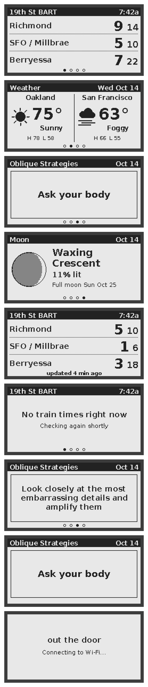

# out-the-door

A small e-ink display for the wall by the front door, running on an Elecrow CrowPanel ESP32-S3 2.13" e-paper board. It cycles through four screens, 20 seconds each:

1. **BART**: the next two trains from 19th St toward Richmond, SFO / Millbrae and Berryessa
2. **Weather**: Oakland and San Francisco right now, with today's high and low
3. **Oblique Strategies**: a card of the day
4. **Moon**: tonight's phase and the next full moon

From 11 pm to 6 am it stops cycling, turns Wi-Fi off and just shows the card of the day. Any button wakes it for two minutes.

**Buttons:** scroll the wheel to flip screens by hand. Press the wheel, or Menu, to jump to fresh train times. Back returns to the trains screen.



## Setup

1. **Check the board revision.** The back of the board says V1.0 or V1.2. Set `PANEL_REVISION` in `include/config.h` to `10` or `12`. V1.0 has an SSD1680 display controller and V1.2 a JD79661, and they are driven differently.
2. **Install PlatformIO.** Either the VS Code extension, or `pip install platformio` for the command line.
3. **Add your Wi-Fi.** Copy `src/secrets.example.h` to `src/secrets.h` and fill it in. You can use BART's shared key or [register your own](https://api.bart.gov/api/register.aspx).
4. **Flash it.** Plug the board in over USB-C and run `pio run -t upload`. If the upload doesn't start, hold BOOT, tap RESET, then release BOOT.
5. **Watch the log.** Run `pio device monitor` to see Wi-Fi and fetch messages.

If the picture comes out upside down, set `PANEL_FLIP_180 1`. If it comes out as a negative, set `PANEL_INVERT 1`.

## Changing things

Everything adjustable is in `include/config.h`: the station, which destinations count for each row, the cities, the time per screen and the quiet hours. The Oblique Strategies cards are in `lib/core/cards.cpp`. It ships with a short starter set, so add the rest of the deck if you have it.

## Working on the screens without the board

`tools/host.sh` builds the drawing and data code for your laptop, runs the checks (time zone, BART and weather parsing, moon phase) and draws every screen into `previews/`. It needs a C++ compiler and git; with Pillow installed (`pip install pillow`) it also writes PNGs. GitHub runs the same checks, plus a full firmware build, on every push.

Fonts are DejaVu Sans, pre-rendered into Adafruit GFX format by `tools/make_fonts.py`.

## Layout

```
include/config.h     settings
src/                 board-only code
  main.cpp           startup, rotation, buttons, fetch schedule, quiet hours
  panel.cpp          e-paper driver for both board revisions
  net.cpp            Wi-Fi, HTTPS, NTP clock
  buttons.cpp        scroll wheel, Menu and Back
lib/core/            portable code (also built on a laptop by tools/host.sh)
  screens.cpp        the four screens and their icons
  bart.cpp           BART departures: URL, parsing, countdown
  weather.cpp        Open-Meteo: URL, parsing, icons
  moon.cpp           moon phase maths
  cards.cpp          Oblique Strategies deck
  clock.cpp          Pacific time and date labels
  text.cpp, fonts/   text drawing in DejaVu Sans
host/                laptop build: shims, checks, sample data
tools/               host.sh, font and preview scripts
```
