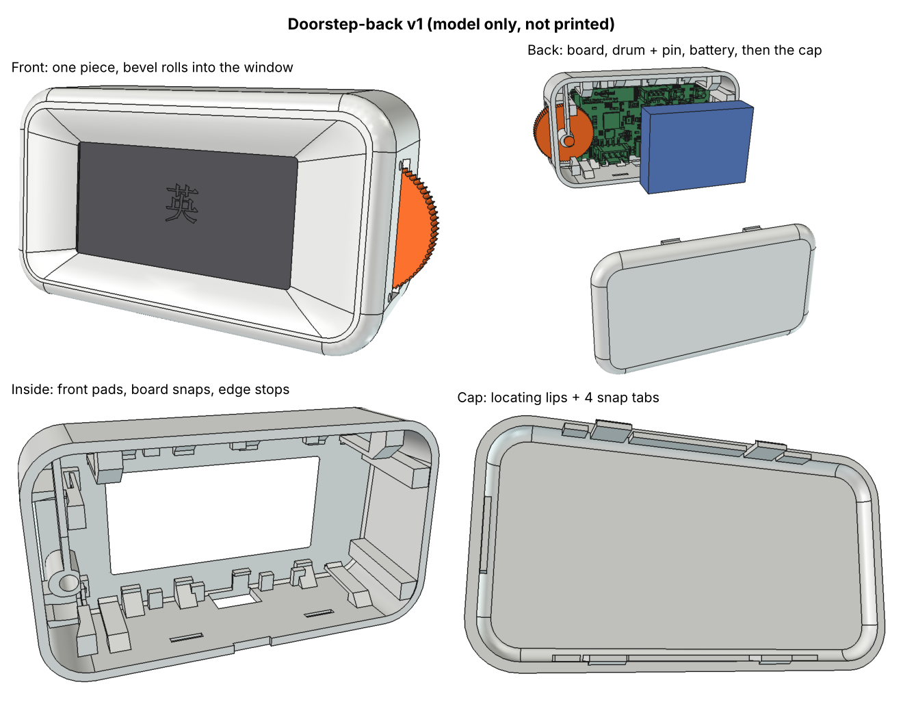

# Doorstep-back

A sibling of [Doorstep](../doorstep/README.md) with the same outside (80 x 44 x 30 mm, 6° lean, orange drum on the right), but no front plate. The front is one piece with the body: a convex bevel rolls from the flat face down to a window 0.3 mm inside the screen's live area. The CrowPanel goes in from the back and a back cap snaps shut.



Read [../DEVELOPMENT.md](../DEVELOPMENT.md) first: it has the rules for part revisions, commits, print and assembly logs.

## Parts

| Part | File | Print |
|---|---|---|
| body | `print-ready/doorstep_back_body_white.stl` | back rim down, front face up; tree supports inside only (under the front wall) |
| cap | `print-ready/doorstep_back_cap_white.stl` | back face down, lips up; no supports |
| drum | `print-ready/latch_drum_orange.stl` | same shape as Doorstep drum-3 |
| pin | `print-ready/latch_pin_orange.stl` | head down |

All four are on one bed in `print-ready/doorstep_back_bed.3mf`. Revisions: [parts.md](parts.md).

## How it goes together
1. Board: screen first, push it in from the back until the 4 snap arms click over its back edge. It stops against 8 pads on its bare front rim, 0.7 mm behind the front wall.
2. Drum: drop it in at the left of the wheel, then slide it right into the side-wall window.
3. Pin: push it in from the back through the post on the springy arm, the drum and the hub. Head stays at the back of the post.
4. Battery in the space behind the board (103040 size). The cap sits 0.5 mm off it; a square of foam tape stops rattles.
5. Cap: press it on until the 4 tabs click into pockets inside the top and bottom walls. To open, put a fingernail in the notch under the seam at the bottom.

## Why a cap and not an inset plate
The opening has to be nearly the whole inside: the board slides in tilted with the case's 6° lean, and the pin goes in at the far right. That leaves no flat rim around an inset plate, so the body would stand on a sliver when printed back-down. The cap is the whole back face plus its 4 mm edge round, split where the round meets the flat sides. The seam is that line.

## Building
Same as Doorstep, from this folder. The CrowPanel STEP goes in `vendor/crowpanel_2.13.step` (see [Doorstep's README](../doorstep/README.md) for where to get it).

```sh
freecadcmd -c "exec(open('src/doorstep_back.py').read())"
freecadcmd -c "exec(open('scripts/orient.py').read())"
freecadcmd -c "exec(open('scripts/mk3mf.py').read())"
xvfb-run -a freecadcmd -c "exec(open('scripts/render_views.py').read())"
```
