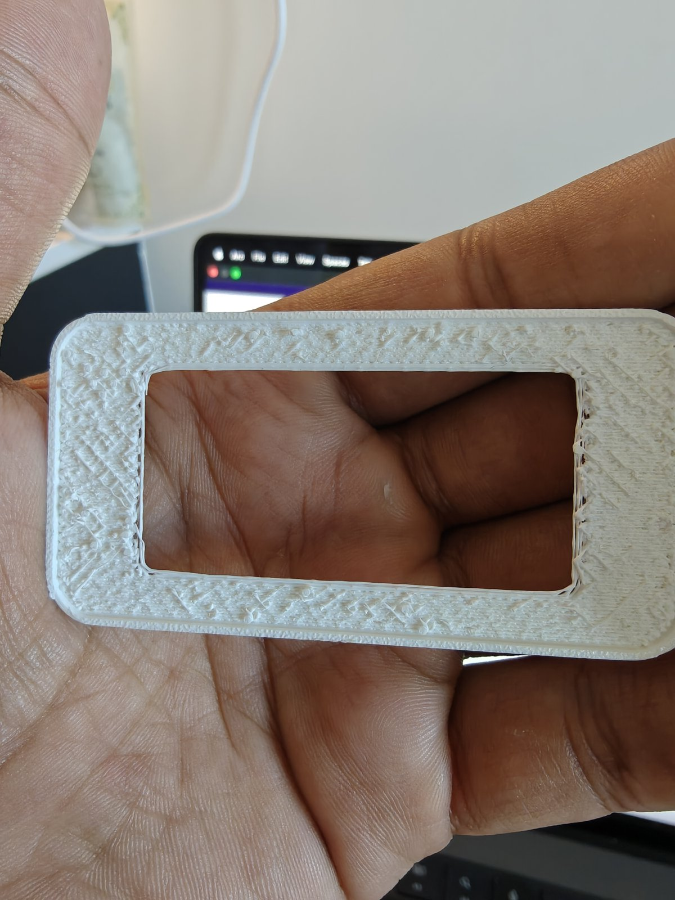
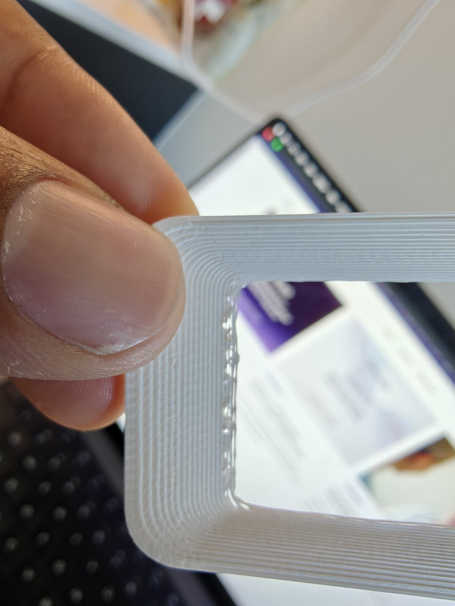
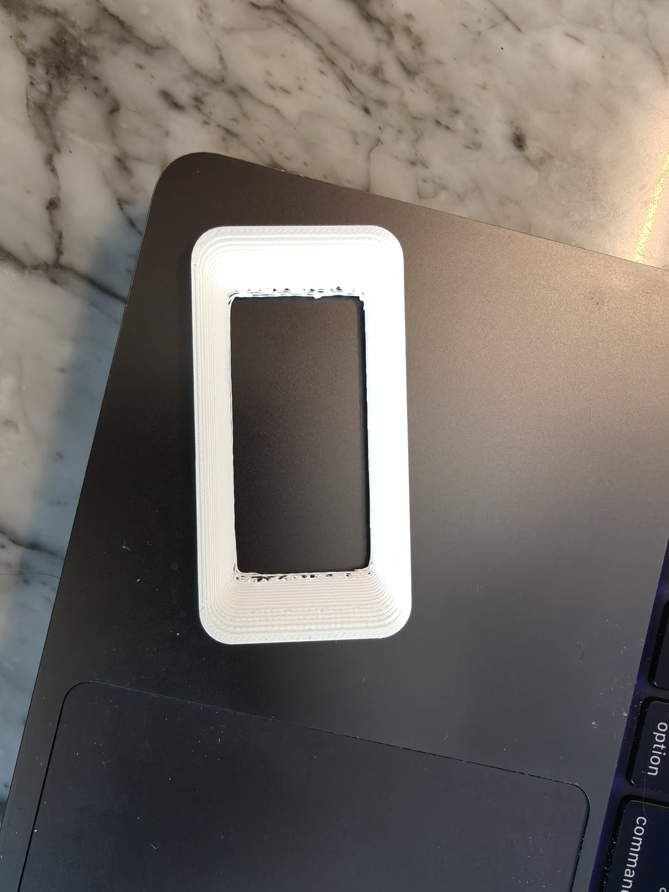
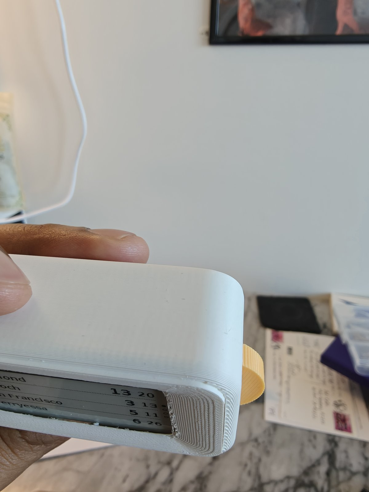
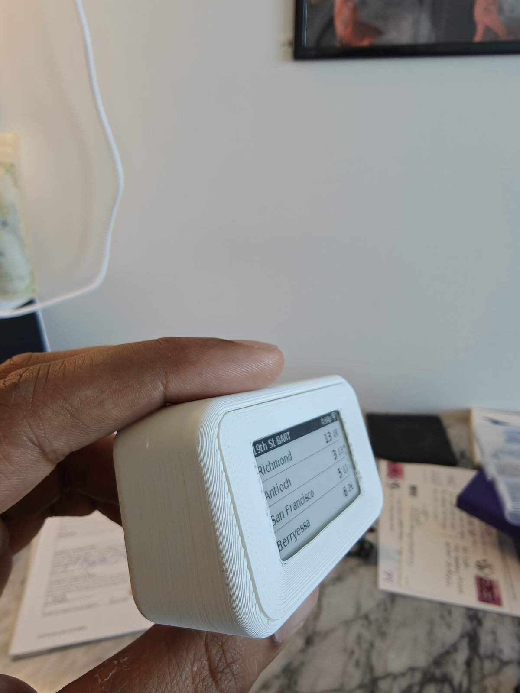
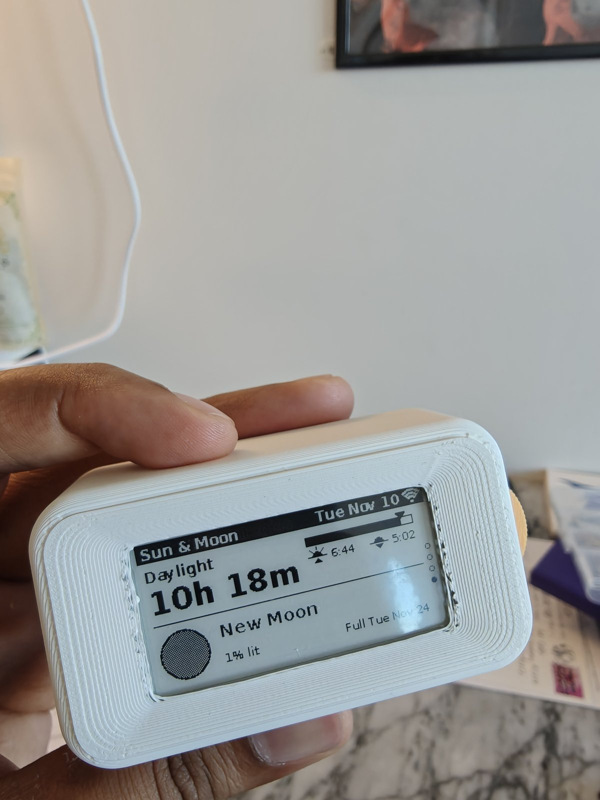
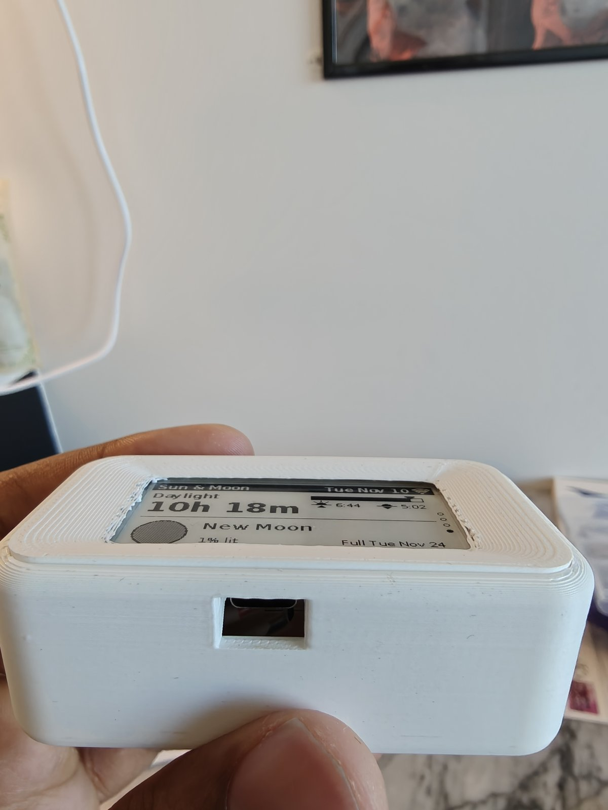

# A4: body-4 + front-4 + drum-3 + pin-2 (all P5)
Built 2026-11-10.

## Board
- Sits really well. Very little up-down wiggle; back-forth and side-to-side wiggle gone (edge stops + leaf springs work).

## Front plate (front-4)
- Printed poorly: heavy stringing at the window (adaptive layers), lots of supports under the back, support residue left after removal.
- Fit on the body poor: plate stands proud and the seam is uneven. Unclear whether that is the residue or the design.
- The small break in the body's groove near the USB end came from taking the front on and off several times.

## Drum
- Needed filing before it would spin, both in the side-wall slot and where it passes the pillars.
- Spins freely on the pin after some oil.
- Turning without pressing does nothing to the wheel; it only catches and turns the wheel when pressed in. The tactile click when it does is really nice, but free spinning may confuse a new user.

## Buttons
- The pillars' press tabs cannot press the buttons: the buttons don't even reach the tab bumps. Not sure if the bump on the lower pillar broke off.

## Body print
- Lots of supports; they mostly came off cleanly.

## Photos
| | |
|---|---|
|  Board in the body, front off |  Same |
|  Wheel end: drum in its slot, two button holes |  Empty body from the front |
|  Empty body |  Button and its press tab: gap between them |
|  Other button and tab |  Corner by the USB end: groove break, support remains |
|  Wheel-end corner: pillars and gussets |  Same, wider |
|  Drum on its pin, seen from inside |  Wheel end with the drum out: ragged slot edges |
|  Drum post on its springy arm | |

### Front plate
| | |
|---|---|
|  Back: support scars all over, lip ring at the edge, strings at the window's short sides |  Window edge: blobs and strings |
|  Front: slope shows as terraces |  Fitted, wheel end: plate proud of the body |
|  Fitted: uneven seam |  Fitted, face on |
|  USB-C opening lines up with the port | |

Videos: none received yet.
