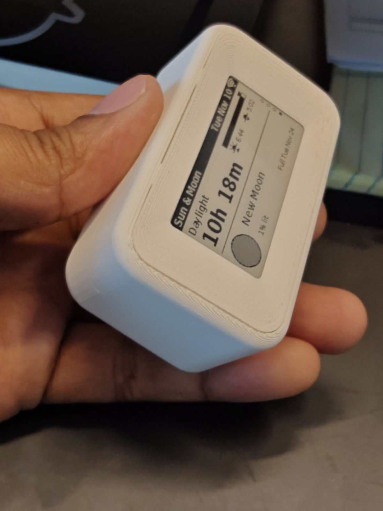
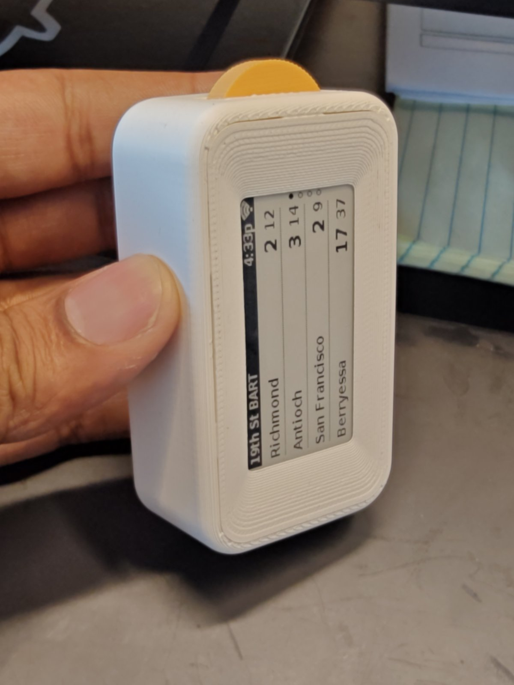
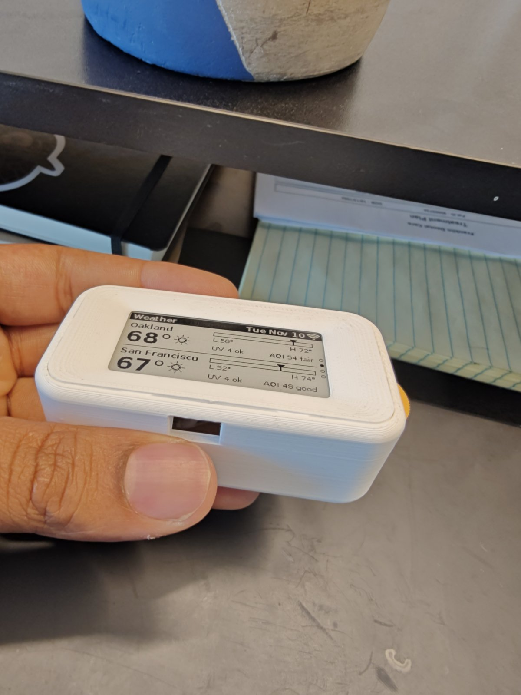

# A5: body-4 + drum-3 + pin-2 (P5) + front-2 (P3)
Built 2026-11-10. Same body, board and drum as [A4](A04.md), with the older ridged, flat-backed front from P3.

- The front fits surprisingly well. Not seamless, but good.
- The window looks better on this body than it did in A3, even though the front is the same.

| | |
|---|---|
|  |  |
|  USB end | |
