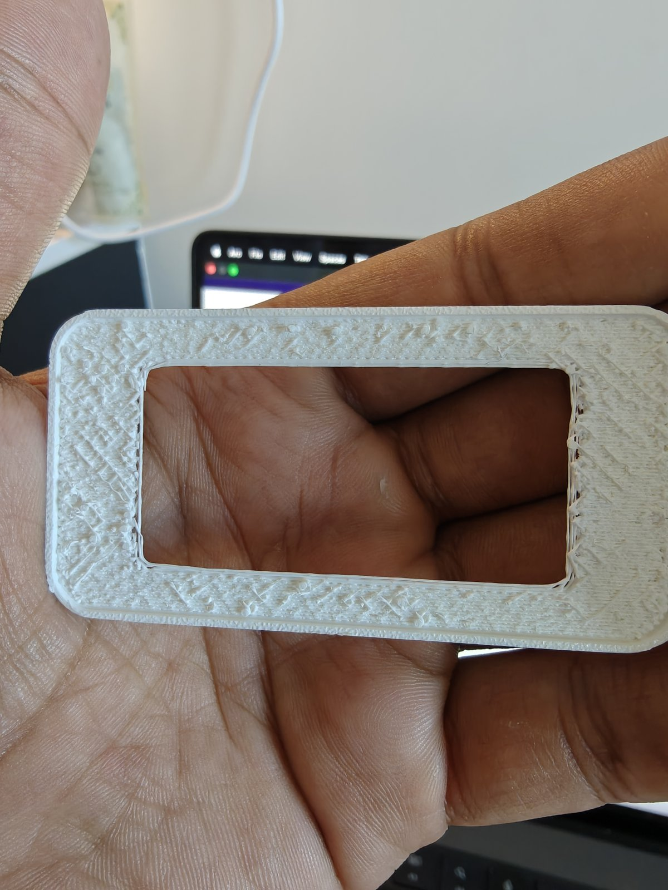
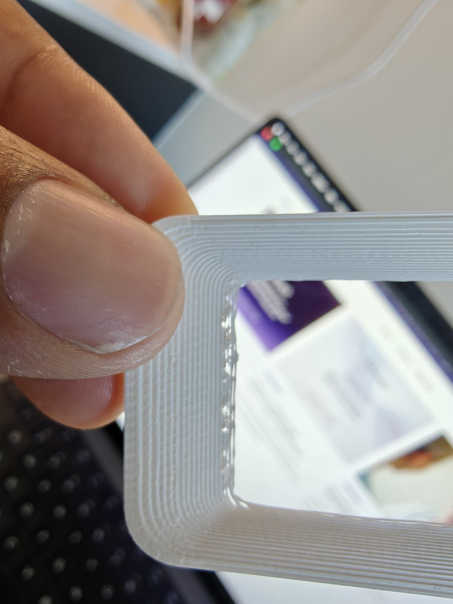
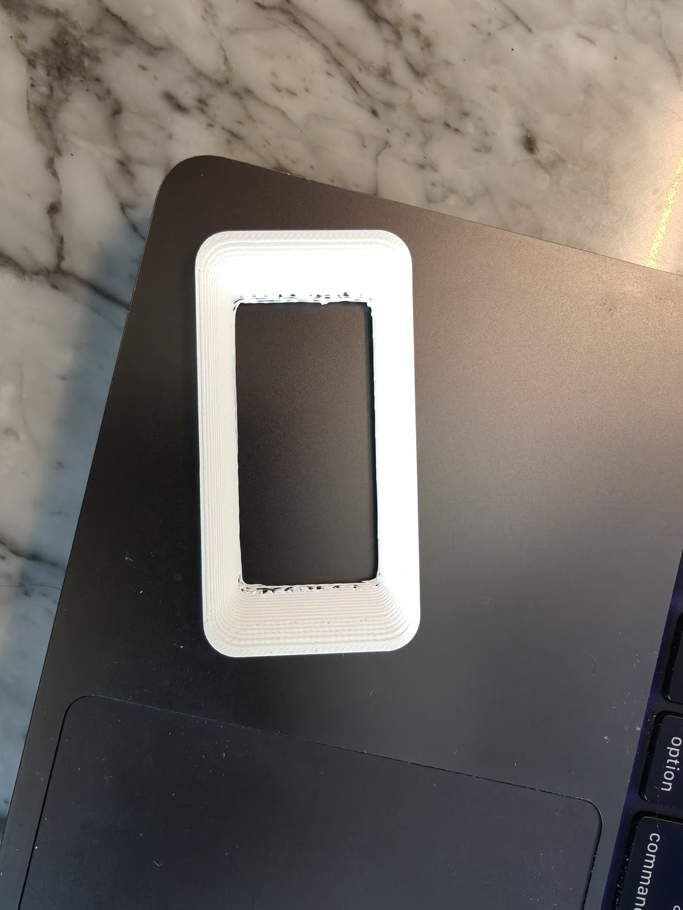
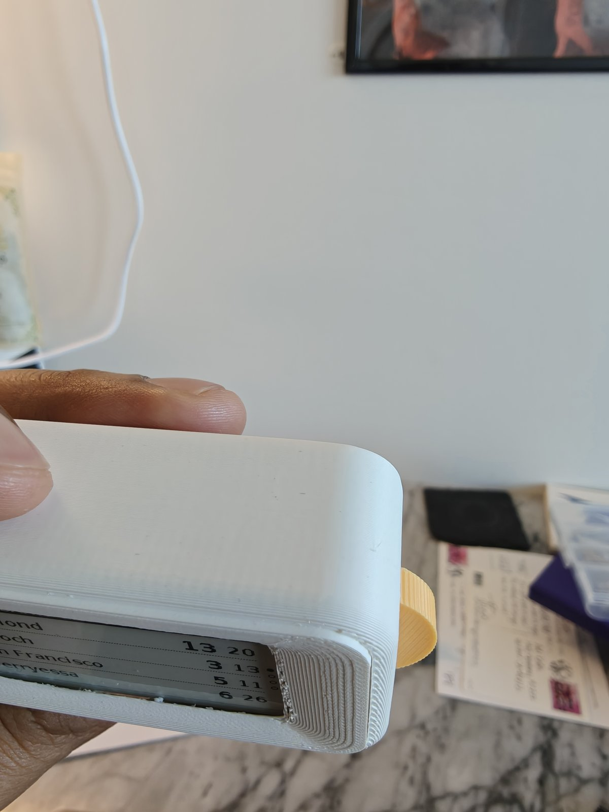
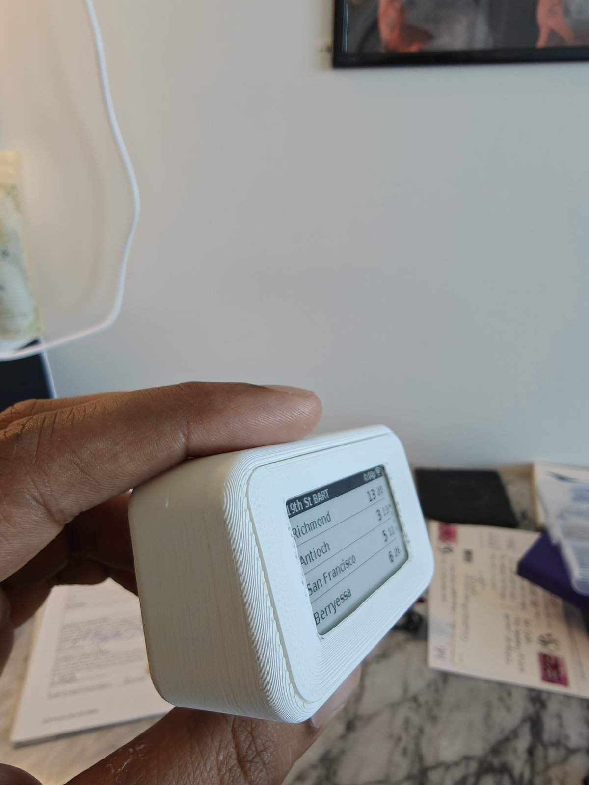
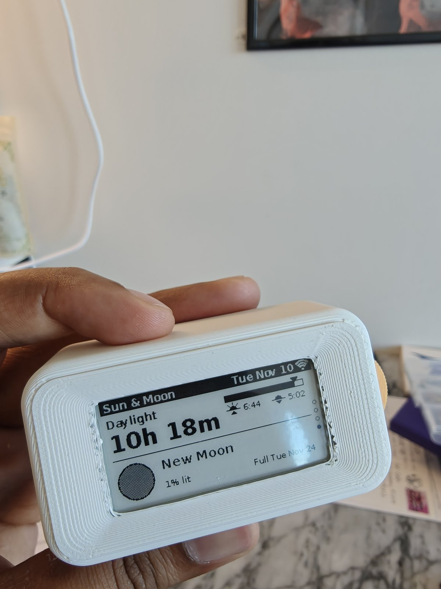
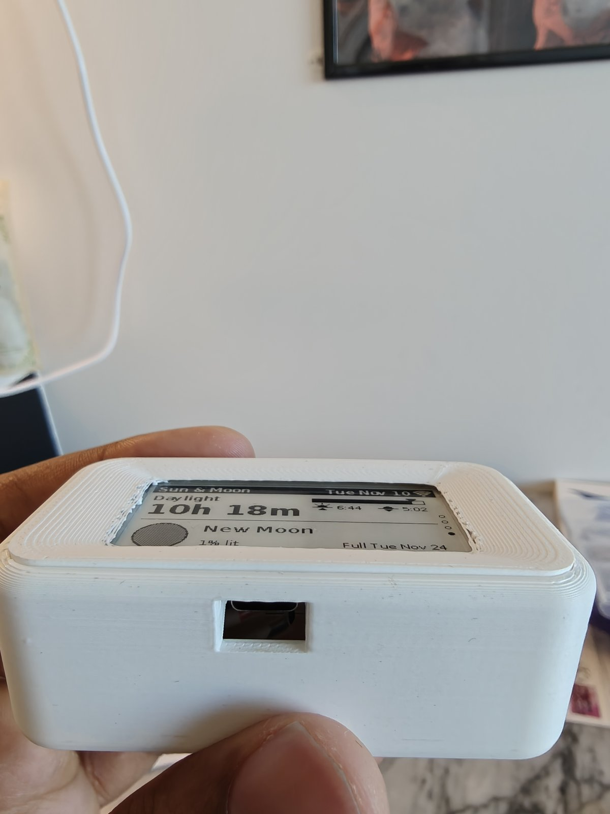

# P5 (2026-11-09 overnight, Pacific)
Model commit `1c2e20c`.

| Part | Revision | Colour | Settings | Result |
|---|---|---|---|---|
| body | body-4? | white | | |
| front | front-4 | white | adaptive layer height; on its lip ring with lots of supports under the back | Poor: heavy stringing at the window; support residue left on the back/bottom after removal; fit on the body poor (debris or real misfit, unclear) |
| drum | drum-3 | orange | | |
| pin | pin-2? | orange | | |

Print problems: (pending). The drum was the plain-hub file (`latch_drum_orange_plain.stl`), which is drum-3; the plate's O-ring drum was not printed.

## Photos (front-4)
| | |
|---|---|
|  Back: support scars over the whole back, lip ring at the edge, strings at the window's short sides |  Window edge: blobs and strings along the short side |
|  Front: slope shows as stepped terraces |  Fitted, wheel end: plate stands proud of the body, rough slope at the window end |
|  Fitted: uneven seam round the plate |  Fitted, face on |
|  USB-C opening lines up with the port; plate sits proud along the top seam | |
